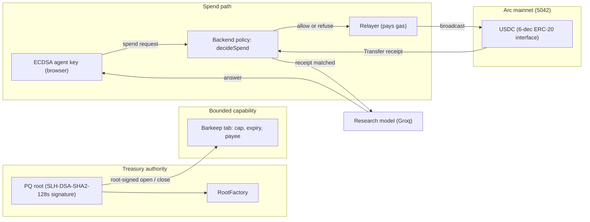
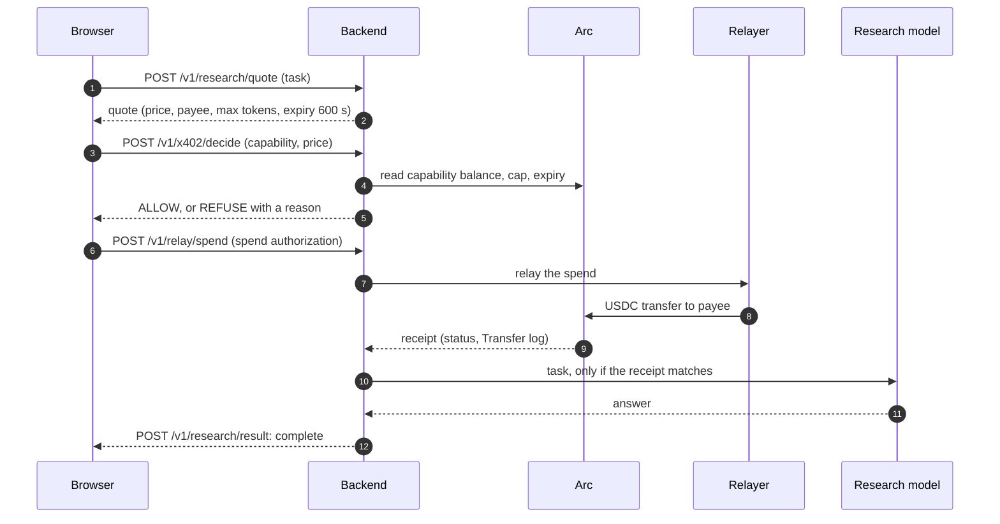

# PQTABS

**Give agents a bounded spending capability on Arc, with a post-quantum root that never has to be online to spend.**

[](https://github.com/mohamedwael201193/PQTABS/actions/workflows/ci.yml)
[](https://docs.arc.io/arc/references/rpc-endpoints)
[](https://pqtabs.vercel.app)

- **Live app:** https://pqtabs.vercel.app
- **Backend API:** https://pqtabs.onrender.com (free plan, may take a moment to wake)
- **Chain:** Arc mainnet, chain ID `5042`, USDC as the gas token

---

## The problem

An AI agent that pays for services needs a wallet. A wallet that holds real treasury USDC and is controlled by an agent key is one leaked key away from losing everything. PQTABS separates the two:

| Concern | How PQTABS handles it |
|---|---|
| Who can move the treasury | A **post-quantum root** signs root-level actions (open, close, transfer, rotate, set exposure). The signature is checked on chain with SLH-DSA-SHA2-128s. |
| How much an agent can spend | A **capability** (a Barkeep tab) holds a fixed USDC cap, an expiry, and a payee. A capability can spend no more than its cap. |
| What happens to a spend request | The backend checks the live balance and cap first (`decideSpend`) and refuses with a stated reason before any signing. |
| Proof that a paid service was paid | The payment is a USDC `Transfer` on Arc. The service result is returned only after that receipt matches the quote. |

## Architecture



## Payment sequence

The research endpoint is an HTTP 402 flow with PQTABS's own scheme name, `pqtabs-barkeep`. It is not the standard x402 `exact` scheme.



Status values returned by the result endpoint: `unpaid`, `result_pending` (receipt matched, no answer yet), and `complete`.

## Mainnet proof

All links open the Arc explorer. The receipt statuses below were read from `https://rpc.mainnet.arc.io` on 2026-10-12.

| Event | Transaction | Block | Status |
|---|---|---|---|
| RootFactory deployment | [`0xfade67cb…c916`](https://explorer.arc.io/tx/0xfade67cbf64d0869dbd33f53bd48844f0b3b4399d2c54b68c36a0b07ba30c916) | 24,623,258 | success |
| Relayed 1-raw USDC transfer | [`0x205114d2…db33d`](https://explorer.arc.io/tx/0x205114d24dcb3c894aa82a394d3709f26c07ffb3ea6dcb40a465546a091db33d) | 24,627,943 | success |
| Capability opened (root-signed) | [`0xc4a85cd1…b363`](https://explorer.arc.io/tx/0xc4a85cd1ed2bef62694ac83bf57f854a774ebe3795b619e536d8c2b982d6b363) | 24,661,830 | success |
| Payment from the capability (1 raw) | [`0x0d17b53c…b3b2`](https://explorer.arc.io/tx/0x0d17b53c3d249eb680c8a868c26d5ae8fbf041b034f946ff92bfb61e8b97b3b2) | 24,663,366 | success |
| Capability closed | [`0x365405cf…f746`](https://explorer.arc.io/tx/0x365405cfb63e70eec08cafd046d474ed901ff12d568811affd53619c7b66f746) | 24,663,813 | success |
| Research payment, answered | [`0x41496d26…76ae`](https://explorer.arc.io/tx/0x41496d2663c553f4948680b24f9de159026c2e2212514b44ffb60eda237076ae) | 25,534,892 | success |

Deployed contract addresses (Arc mainnet):

| Contract | Address |
|---|---|
| RootFactory | [`0x05545F026b75f03aE9Cf1eA8a8373473c94ed323`](https://explorer.arc.io/address/0x05545F026b75f03aE9Cf1eA8a8373473c94ed323) |
| PQRoot implementation | [`0xb147Ec122E0b8F91dC4398dD0746372fdC22A894`](https://explorer.arc.io/address/0xb147Ec122E0b8F91dC4398dD0746372fdC22A894) |
| Barkeep tab implementation | [`0x89B63f2E43dea9014750925C01996D34856B01D2`](https://explorer.arc.io/address/0x89B63f2E43dea9014750925C01996D34856B01D2) |
| USDC (ERC-20 interface) | [`0x3600000000000000000000000000000000000000`](https://explorer.arc.io/address/0x3600000000000000000000000000000000000000) |

The addresses are taken from `deployments/mainnet.json` and `backend/src/constants.ts`. The factory and USDC have bytecode on chain, read on 2026-10-12.

## Security model

- **Root authority.** Root actions carry a nonce and a deadline inside the signed digest (`PQRoot.digestFor`). `PQRoot.execute` checks the SLH-DSA-SHA2-128s signature on chain and is guarded by `nonReentrant`.
- **Exposure ceiling.** Each root is created with a `maxOpenExposure` ceiling (`RootFactory.createRoot`). Opening a capability cannot push open exposure above it.
- **Capability limits.** A capability holds a fixed cap, an expiry, and a payee. The backend refuses a spend when the balance is empty or the price exceeds what remains (reason `balance`) before any signing.
- **Agent key.** The agent signs spend requests with an ECDSA key held in the browser. The backend never receives the root key. The app never asks for a private key or a signature paste.
- **Relayer.** The relayer pays gas and broadcasts transactions. Root actions need the post-quantum signature, which the relayer does not hold.
- **Replay and quotes.** A research quote binds the task, price, payee, and max tokens by hash (`researchBodyHash`) and expires after 600 seconds.
- **Failure states.** A matched receipt with a missing answer is reported as `result_pending`, not as complete. A refused spend says why. Read traffic and relay traffic use separate rate-limit buckets, and the relay bucket is limited to a fixed number of requests per minute (the suite checks the ninth request inside one minute is refused).

Known limits, stated plainly:

- Arc's public RPC rate-limits reads. The backend retries rate-limited calls. A `429` from `/v1/x402/decide` is usually a read limit, not a refusal of the payment.
- Closing a capability needs the root's security-key unlock in the browser.
- A capability with a zero balance still counts its cap toward open exposure until it is closed.

## Test totals

Verified on 2026-10-12 from this repository at commit `6299974` (research answer quality).

| Suite | Command | Result |
|---|---|---|
| Backend unit and integration | `npm test` in `backend/` | 63 passed, 0 failed, exit 0 |
| Backend lint | `npm run lint` in `backend/` | exit 0 |
| Frontend node tests | `node --experimental-strip-types --test` over the 21 `frontend/src/**/*.test.ts` files | 69 passed, 0 failed, exit 0 |
| Signer (Rust) | `cargo test --manifest-path signer/Cargo.toml` | 8 passed (5 + 3), exit 0 |
| Contracts (Foundry) | `forge test` | 17 test functions in 2 files (grep count). Foundry is not installed locally; the CI `contracts` job passed. |
| Pins and secrets | `python scripts/check_pins.py`, `python scripts/secret_scan.py` | pass |
| CI | GitHub Actions `ci` | the latest completed run on `23f3d26` passed all five jobs: contracts, signer, backend, pins-and-secrets, slither |

## Quick start

Prerequisites: Node 22, npm, and Rust with `cargo`. Foundry is optional.

```bash
git clone https://github.com/mohamedwael201193/PQTABS.git
cd PQTABS

# backend
cd backend
npm ci
npm test
npm run lint
cd ..

# frontend
cd frontend
npm ci
npx next dev -p 3000   # http://localhost:3000

# signer
cargo test --manifest-path signer/Cargo.toml
```

### Environment variables

Set these in your shell or in a `.env` file that is never committed. Only the names are listed here. Values are yours to provide.

| Variable | Used by | Purpose |
|---|---|---|
| `ARC_RPC_URL` | backend | Arc RPC endpoint |
| `ARC_CHAIN_ID` | backend | `5042` on mainnet |
| `ARC_EXPLORER_URL` | backend | explorer base URL |
| `USDC_ADDRESS` | backend | USDC ERC-20 interface |
| `FACTORY_ADDRESS` | backend | RootFactory |
| `MERCHANT_PAYEE` | backend | research payee, a public USDC address |
| `RESEARCH_PRICE_RAW` | backend | research price in raw USDC |
| `AI_PRIMARY_PROVIDER` | backend | research model provider |
| `GROQ_API_KEY`, `GROQ_BASE_URL`, `GROQ_MODEL` | backend | research model access |
| `RELAYER_PRIVATE_KEY` | backend | relayer signing key (secret) |
| `DATABASE_URL` | backend | Postgres for the indexer |
| `NEXT_PUBLIC_BACKEND_URL` | frontend | backend base URL |
| `NEXT_PUBLIC_CHAIN_ID` | frontend | `5042` |
| `NEXT_PUBLIC_EXPLORER_URL` | frontend | explorer base URL |

Never put private keys, API keys, or encrypted backups in a commit. The repository's secret scan runs in CI.

## Validate a mainnet receipt, read-only

This needs no wallet and spends nothing. Replace `<TX_HASH>` with a transaction hash.

```bash
curl -s https://rpc.mainnet.arc.io \
  -H 'content-type: application/json' \
  -d '{"jsonrpc":"2.0","id":1,"method":"eth_getTransactionReceipt","params":["<TX_HASH>"]}'
```

Check three things in the result:

1. `"status": "0x1"` means the transaction succeeded.
2. `"to"` is `0x3600000000000000000000000000000000000000` for a USDC transfer.
3. A log with `"address"` equal to that USDC address and `topics[0]` equal to `0xddf252ad1be2c89b69c2b068fc378daa952ba7f163c4a11628f55a4df523b3ef` (ERC-20 `Transfer`) carries the 6-decimal amount in `data`.

Arc's native USDC also emits a `Transfer` event at `0xffffFFFfFFffffffffffffffFfFFFfffFFFfFFfE` with 18 decimals. Only the ERC-20 log above is the payment amount.

Worked example: the research payment `0x41496d26…76ae` has one ERC-20 `Transfer` log whose `data` decodes to `360`. At 6 decimals that is `0.00036 USDC`, the research price.

## Troubleshooting

| Symptom | Likely cause | What to do |
|---|---|---|
| `429` from `/v1/x402/decide` | Arc RPC read limit | Wait a few seconds and retry once |
| `eth_getLogs` error `-32012` | Block range over 10,000 | Page in ranges of 9,999 blocks or fewer |
| `eth_getLogs` error `-32014` | Load-balanced RPC node near the head | Retry with backoff |
| Refused with reason `balance` | Capability balance is zero or below the price | Check the capability's remaining balance; a capability with a zero balance still counts its cap toward exposure until it is closed |
| `503` `merchant_unconfigured` on quote | `MERCHANT_PAYEE` is not set | Set the variable on the backend |
| Answer says the sources do not cover a question | Model answer had no cited Arc fact | Ask a question covered by the cited facts. The payment is still a real receipt. |
| Local test fails on `dist/` files | Build step skipped | Run `npm test` from `backend/`, which compiles first |

## Official Arc documentation

- [RPC endpoints](https://docs.arc.io/arc/references/rpc-endpoints)
- [Deterministic finality](https://docs.arc.io/arc/concepts/deterministic-finality)
- [Consensus layer](https://docs.arc.io/arc/concepts/consensus-layer)
- [Stablecoin-native model (USDC gas)](https://docs.arc.io/arc/concepts/stablecoin-native-model)
- [Gas and fees](https://docs.arc.io/arc/references/gas-and-fees)
- [Contract addresses](https://docs.arc.io/arc/references/contract-addresses)
- [Post-quantum security](https://docs.arc.io/arc/concepts/post-quantum-security)
- [Opt-in privacy](https://docs.arc.io/arc/concepts/opt-in-privacy)

## Roadmap

Only items marked **Live** run in production today.

| Item | Status | Basis |
|---|---|---|
| Bounded capabilities with a root-signed lifecycle | Live | mainnet receipts above |
| Post-quantum root verification (SLH-DSA-SHA2-128s) | Live | Arc docs: live on mainnet through the PQ verification precompile |
| Paid research answers with receipt matching | Live | mainnet receipts above |
| Native post-quantum wallet signing | Planned by Arc, not yet available | Arc docs: a future milestone |
| Arc Privacy Sector | Not yet available | Arc docs |
| Proof-of-stake validator set | Potential future transition, not live | Arc docs: consensus layer |
| Gas paid in other stablecoins | Not supported at launch | Arc docs: stablecoin-native model |
| Services beyond Arc research | Not built | This repository has one paid service |

## Repository layout

| Path | Contents |
|---|---|
| `contracts/` | `PQRoot`, `RootFactory`, and the Foundry tests |
| `signer/` | Rust SLH-DSA signer used by the browser |
| `backend/` | Hono API, indexer, policy checks, relayer, research pipeline |
| `frontend/` | Next.js app and landing page |
| `deployments/mainnet.json` | deployed addresses and transaction hashes |
| `scripts/` | pins check and secret scan |

## License and contact

See the repository for license terms. Issues and questions are welcome on [GitHub](https://github.com/mohamedwael201193/PQTABS/issues).
