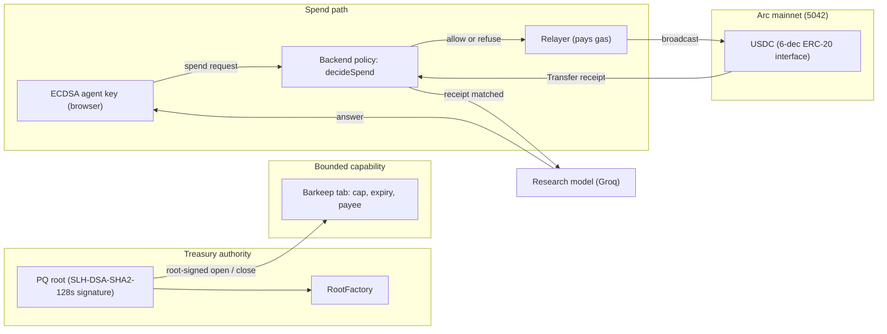
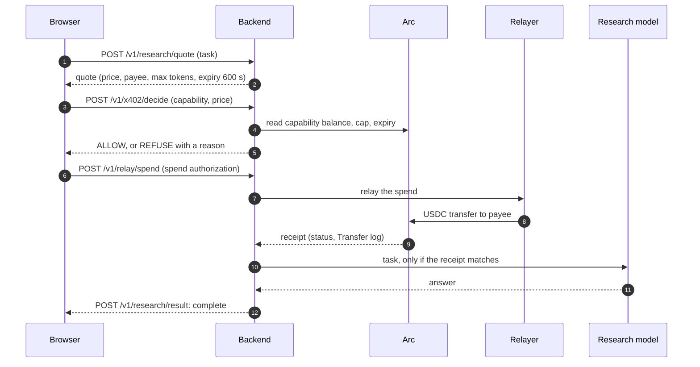

# PQTABS

**Give agents a bounded spending capability on Arc, with a post-quantum root that never has to be online to spend.**

[](https://github.com/mohamedwael201193/PQTABS/actions/workflows/ci.yml)
[](https://docs.arc.io/arc/references/rpc-endpoints)
[](https://pqtabs.vercel.app)

- **Live app:** https://pqtabs.vercel.app
- **Backend API:** https://pqtabs.onrender.com (free plan, may take a moment to wake)
- **Chain:** Arc mainnet, chain ID `5042`, USDC as the gas token
- **Judge check:** [JUDGE-QUICKSTART.md](JUDGE-QUICKSTART.md) verifies a receipt, the contracts, and a read-only MCP call. No wallet.

---

## The problem

An AI agent that pays for services needs a wallet. A wallet that holds real treasury USDC and is controlled by an agent key is one leaked key away from losing everything. PQTABS separates the two:

| Concern | How PQTABS handles it |
|---|---|
| Who can move the treasury | A **post-quantum root** signs root-level actions (open, close, transfer, rotate, set exposure). The signature is checked on chain with SLH-DSA-SHA2-128s. |
| How much an agent can spend | A **capability** (a Barkeep tab) holds a fixed USDC cap, an expiry, and a payee. A capability can spend no more than its cap. |
| What happens to a spend request | The backend checks the live balance and cap first (`decideSpend`) and refuses with a stated reason before any signing. |
| Proof that a paid service was paid | The payment is a USDC `Transfer` on Arc. The service result is returned only after that receipt matches the quote. |

## Architecture



## Payment sequence

The research endpoint is an HTTP 402 flow with PQTABS's own scheme name, `pqtabs-barkeep`. It is not the standard x402 `exact` scheme.



Status values returned by the result endpoint: `unpaid`, `result_pending` (receipt matched, no answer yet), and `complete`.

## Mainnet proof

All links open the Arc explorer. The receipt statuses below were read from `https://rpc.mainnet.arc.io` on 2026-10-12.

| Event | Transaction | Block | Status |
|---|---|---|---|
| RootFactory deployment | [`0xfade67cb…c916`](https://explorer.arc.io/tx/0xfade67cbf64d0869dbd33f53bd48844f0b3b4399d2c54b68c36a0b07ba30c916) | 24,623,258 | success |
| Relayed 1-raw USDC transfer | [`0x205114d2…db33d`](https://explorer.arc.io/tx/0x205114d24dcb3c894aa82a394d3709f26c07ffb3ea6dcb40a465546a091db33d) | 24,627,943 | success |
| Capability opened (root-signed) | [`0xc4a85cd1…b363`](https://explorer.arc.io/tx/0xc4a85cd1ed2bef62694ac83bf57f854a774ebe3795b619e536d8c2b982d6b363) | 24,661,830 | success |
| Payment from the capability (1 raw) | [`0x0d17b53c…b3b2`](https://explorer.arc.io/tx/0x0d17b53c3d249eb680c8a868c26d5ae8fbf041b034f946ff92bfb61e8b97b3b2) | 24,663,366 | success |
| Capability closed | [`0x365405cf…f746`](https://explorer.arc.io/tx/0x365405cfb63e70eec08cafd046d474ed901ff12d568811affd53619c7b66f746) | 24,663,813 | success |
| Research payment, answered | [`0x41496d26…76ae`](https://explorer.arc.io/tx/0x41496d2663c553f4948680b24f9de159026c2e2212514b44ffb60eda237076ae) | 25,534,892 | success |

Deployed contracts, read on 2026-10-13. Hashes and the compiler settings are in [CONTRACT-VERIFICATION.md](CONTRACT-VERIFICATION.md).

| Contract | Address | Source |
|---|---|---|
| RootFactory | [`0x0554…d323`](https://explorer.arc.io/address/0x05545F026b75f03aE9Cf1eA8a8373473c94ed323) | [Sourcify match](https://sourcify.dev/server/v2/contract/5042/0x05545F026b75f03aE9Cf1eA8a8373473c94ed323) |
| PQRoot implementation | [`0xb147…A894`](https://explorer.arc.io/address/0xb147Ec122E0b8F91dC4398dD0746372fdC22A894) | [Sourcify match](https://sourcify.dev/server/v2/contract/5042/0xb147Ec122E0b8F91dC4398dD0746372fdC22A894) |
| Barkeep factory | [`0xcceb…443c`](https://explorer.arc.io/address/0xccebC58DD1F5937B36D5f9F89f0754424f4D443c) | Bytecode on chain. Source not verified. |
| Barkeep tab implementation | [`0x89B6…01D2`](https://explorer.arc.io/address/0x89B63f2E43dea9014750925C01996D34856B01D2) | Bytecode on chain. Source not verified. |
| USDC ERC-20 interface | [`0x3600…0000`](https://explorer.arc.io/address/0x3600000000000000000000000000000000000000) | Arc system contract. Not a PQTABS deployment. |
| PQ precompile | [`0x1800…0004`](https://explorer.arc.io/address/0x1800000000000000000000000000000000000004) | Arc precompile. Not a Solidity contract. |

The live root `0x2d0F…6b95` is a 45-byte clone of the matched PQRoot implementation. Treasury movement inside a root (fund, open, close, reclaim) is not the same thing as a paid research answer. The research payment in the table above is 360 raw (0.00036 USDC). The staging lifecycle in `deployments/mainnet.json` moved larger but still sub-dollar amounts. Neither is a claim that a large treasury has been put under this root.

## Security model

- **Root authority.** Root actions carry a nonce and a deadline inside the signed digest (`PQRoot.digestFor`). `PQRoot.execute` checks the SLH-DSA-SHA2-128s signature on chain and is guarded by `nonReentrant`.
- **Exposure ceiling.** Each root is created with a `maxOpenExposure` ceiling (`RootFactory.createRoot`). Opening a capability cannot push open exposure above it.
- **Capability limits.** A capability holds a fixed cap, an expiry, and a payee. The backend refuses a spend when the balance is empty or the price exceeds what remains (reason `balance`) before any signing.
- **Agent key.** The agent signs spend requests with a classical ECDSA key, which is separate from the post-quantum root. The key lives in one of two places: the browser vault (AES-GCM encrypted with a non-extractable device key in IndexedDB) or the local signer on Windows (DPAPI). The backend never receives the agent or root key. The app never asks for a private key. The one signature it asks you to paste is the Developer Page pairing signature, which proves control of the address and authorizes nothing.
- **Local signer (Windows).** `pqtabs-signer` keeps an agent key encrypted with Windows DPAPI for the current user, under `%LOCALAPPDATA%\pqtabs-signer\keys`. The MCP server starts the signer as a child process and receives only the 65-byte signature for each approved authorization. On this path the MCP process never holds the raw key. DPAPI does not protect against code that already runs as the same user.
- **Relayer.** The relayer pays gas and broadcasts transactions. Root actions need the post-quantum signature, which the relayer does not hold.
- **Circle wallets.** Circle's agent wallet from the CLI is a smart contract account. Barkeep's tab accepts only an ECDSA signature from an externally owned account, so that wallet cannot be the agent. The tab requires the recovered ECDSA signer to equal `agent()`, and the on-chain check ran for EOA agents only, so this contract-wallet conclusion is inferred from that rule and was not tested live. Circle's docs list only `ARC-TESTNET` in the Wallets and CCTP tables, so the mainnet chain code `ARC` used by the adapter is unverified. A Circle developer-controlled EOA has a signer adapter (`circleDeveloperSigner` in `pqtabs-sdk`). Its digest reproduces the signer that Barkeep accepted for a mined Arc spend (an offline known vector). A live Circle signature has not been produced, so the compatibility of Circle's live signing is not proven. It needs your own Circle credentials and an approved test.
- **Replay and quotes.** A research quote binds the task, price, payee, and max tokens by hash (`researchBodyHash`) and expires after 600 seconds.
- **Failure states.** A matched receipt with a missing answer is reported as `result_pending`, not as complete. A refused spend says why. Read traffic and relay traffic use separate rate-limit buckets, and the relay bucket is limited to a fixed number of requests per minute (the suite checks the ninth request inside one minute is refused).

## What is enforced where

PQTABS enforces the post-quantum authorization, the nonce, the deadline, the exposure ceiling, and the open and close accounting. Those rules are in the Sourcify-matched `PQRoot` source.

Barkeep enforces the capability's agent, payee list, per-call maximum, expiry, and the check that a spend signature recovers to that agent. That bytecode is on mainnet and is not source-verified. The tests use a mock of it. The deployed `PQRoot` does not read `agent()`, `payees()`, or `maxPerCall()` back after opening. `PQRootNext` does, and it is not deployed.

## If the post-quantum key is lost

The deployed root has one verifying key. `execute` accepts only a signature under that key. There is no admin, no ECDSA override, and no upgrade path on an existing clone. A lost key cannot authorize a replacement. The USDC in that root stays there.

`PQRootNext` (not deployed) is a separate implementation with a 7-day delayed rotation:

- The spending key can schedule a new key. If a backup PQ key was set at creation, only that backup key can cancel the schedule. Transfers and new capabilities pause while it is pending.
- The backup key can schedule a new spending key. Only the current spending key can cancel that schedule. This is the path when the spending key is lost and the backup key is not.
- After 7 days anyone can execute the pending key. Immediate rotation is removed in this version.
- A stolen spending key can still be cancelled by the backup key, and the reverse. If both keys are lost or both are stolen, this does not help. Existing roots do not gain this by a transaction. They would need a new factory and a new root. Moving funds requires the current key.

## Standard x402

The live research quote advertises only `pqtabs-barkeep`. It is not the standard `exact` scheme, and a stock x402 client cannot pay it.

Circle's facilitator documentation lists Arc mainnet as `eip155:5042` with this USDC contract for the `exact` scheme: https://developers.circle.com/facilitator-service/supported-networks . That page was read on 2026-10-13. PQTABS does not call that facilitator. `backend/src/index/exact-settlement.ts` builds an `exact` accept and checks a settlement report (network, asset, payee, amount, quote, expiry, replay, failed status). Those checks are unit-tested. The live quote does not include the row, because no unmodified client has settled a PQTABS quote through a facilitator.

## Idle treasury

No yield integration is deployed. The address `0x8E357432CC12ff425c36432F312968aEb16112AF` has bytecode on Arc (21,808 bytes) and no Sourcify verification. PQTABS does not send treasury there. Unallocated root USDC earns nothing. Funds inside an open capability are reserved by `openExposure` and are not available to a strategy.

## Circle signing

Circle's CLI agent wallet is a smart contract account. The tab requires the recovered ECDSA signer to equal `agent()`. That on-chain check was run for EOA agents. The contract-wallet case is inferred from that rule and was not tested live. A Circle developer-controlled EOA adapter reproduces the digest of a mined Arc spend offline. No live Circle signature has been produced. Barkeep compatibility with Circle is not verified.

Known limits, stated plainly:

- Arc's public RPC rate-limits reads. The backend retries rate-limited calls. A `429` from `/v1/x402/decide` is usually a read limit, not a refusal of the payment.
- Closing a capability needs the root's security-key unlock in the browser.
- `pqtabs-mcp` 0.1.2 on npm starts the local signer when `PQTABS_SIGNER_CLI` and `PQTABS_SIGNER_AGENT` are set, so the MCP process never holds the key. Versions 0.1.1 and earlier read `PQTABS_AGENT_PRIVATE_KEY` from their environment, which puts the key in the server process. The signer itself is Windows-only (DPAPI) and is not published to npm. Install and check it with `packages/pqtabs-signer/scripts/install-windows.ps1`. macOS and Linux fail closed: no key is stored there. The signer README lists what a store for another platform must provide. The MCP configuration points at the built CLI.
- A receipt that Arc has not returned yet is shown as pending, not failed. The frontend waits up to 90 seconds with bounded backoff on `-32014`, then tells you to check the explorer before you retry. Only a `success` or `reverted` receipt is treated as a result.
- Portfolio reads scan each root only from the last scanned block, not from the factory deploy block. A fresh read is cached for 10 seconds, and a live scan is refused with `503` while the RPC is rate-limiting.
- A capability with a zero balance still counts its cap toward open exposure until it is closed. `PQRoot` adds the cap to `openExposure` on open and subtracts it only on close. Closing needs a root-signed close, or, after the capability's expiry, anyone can call `reclaim(tab)`, which is permissionless and costs gas. On the mainnet root `0x2d0F…6b95`, `maxOpenExposure` is 10,000 raw USDC (0.01 USDC), so one 360-raw capability uses 3.6% of the ceiling until it is closed. The ceiling is a root setting and changing it needs a root action.

## Test totals

Rows marked **today** were run on 2026-10-13 after the verification pass: the Circle known vectors, single-use pairing (commit `215c72b`), and the CI, lint, signer-install, and usage-measurement changes that follow it. Other rows are older runs and say so.

| Suite | Command | Result |
|---|---|---|
| Backend unit and integration | `npm test` in `backend/` | 95 passed, 0 failed, on 2026-10-13 locally. Includes the exact-settlement checks. CI on `6bd578a` was 92, before that file. |
| Backend lint | `npm run lint` in `backend/` | exit 0 (today) |
| SDK unit tests | `npm test` in `packages/pqtabs-sdk/` | 63 passed, 0 failed, exit 0 (today). Includes the Circle adapter vectors and two offline known vectors from the mined Arc spend `0x5358ec04…65b5` (the adapter digest recovers to the agent that Barkeep accepted) |
| MCP unit tests | `npm test` in `packages/pqtabs-mcp/` | 19 passed, 0 failed, exit 0 (today). Includes the local signer boundary |
| Local signer (TypeScript) | `npm test` in `packages/pqtabs-signer/` | 43 passed, 0 failed, exit 0 (today). Includes the pairing-message vector and refusal of another agent |
| SDK, MCP, and signer lint | `npx biome check` in each package | exit 0 (today) |
| Frontend typecheck | `npx tsc --noEmit` in `frontend/` | 0 errors (today) |
| Frontend production build | `npx next build` in `frontend/` | compiles, prerenders `/`, `/_not-found`, and `/developers` (today) |
| Receipt wait | `npm run test:receipt` in `frontend/` | 9 passed, 0 failed, exit 0 (today). A timeout or transient RPC error is pending, never failed |
| Developer address field | `node --experimental-strip-types --test src/components/pqtabs/developers/agent-address.test.ts` | 3 passed, 0 failed, exit 0 (today). Refuses key-shaped input |
| Developer pairing and session | `node --experimental-strip-types --test` on `pairing.test.ts` and `developer-session.test.ts` | 6 and 6 passed, 0 failed, exit 0 (today). The pairing vector matches the signer, and a lowercase address pairs as its checksum form |
| Frontend lint ratchet | `npm run lint:ratchet` in `frontend/` | Passes (today). The 25 existing errors (17 `react-hooks/refs`, 8 `react-hooks/set-state-in-effect`) and 2 generated-file warnings are recorded in `frontend/lint-baseline.json`. The ratchet fails on any new or increased problem. The baseline is not a claim that these are safe; fixing them is open work |
| Frontend node tests | `npm test` in `frontend/` (runs all 25 `src/**/*.test.ts` files) | 93 passed, 0 failed, exit 0 (today) |
| Signer (Rust) | `cargo test --manifest-path signer/Cargo.toml` | 8 passed (5 + 3), exit 0 |
| Contracts (Foundry) | `forge test` | 30 passed, 0 failed, on 2026-10-13 locally (`PQRoot` 17 including the Rust digest check, `Recovery` 12, exposure invariant 1). `PQRootNext` is not deployed. |
| Pins and secrets | `python scripts/check_pins.py`, `python scripts/secret_scan.py` | pass (today). The secret scan matches env-style assignments only (`NAME=value` at line start), so ordinary code such as `const token = ...` is no longer flagged. 370 tracked files scanned (today, before the release commit) |
| Published MCP clean-consumer smoke | `packages/scripts/clean-consumer-smoke.mjs` against the npm package `pqtabs-mcp` 0.1.2 | `SMOKE_OK`, including the local-signer step that lists the paid tool and reports `paidResearchEnabled` with no spend (today) |
| CI | GitHub Actions `ci` | jobs: contracts, signer (Rust), backend (test and lint), sdk-and-mcp (lint, typecheck, test on Ubuntu), frontend (`tsc --noEmit`, lint ratchet, node tests on Ubuntu), pqtabs-signer (lint and test on Windows, isolated key directory), pins-and-secrets, slither. The status of the latest run is on the [ci workflow page](https://github.com/mohamedwael201193/PQTABS/actions/workflows/ci.yml) |

## Quick start

Prerequisites: Node 22, npm, and Rust with `cargo`. Foundry is optional.

```bash
git clone https://github.com/mohamedwael201193/PQTABS.git
cd PQTABS

# backend
cd backend
npm ci
npm test
npm run lint
cd ..

# frontend
cd frontend
npm ci
npx tsc --noEmit
npm run lint:ratchet   # no new lint problems beyond frontend/lint-baseline.json
npm test               # 93 node tests
npx next dev -p 3000   # http://localhost:3000
cd ..

# SDK and MCP (one npm workspace in packages/)
cd packages
npm ci
npm test --workspaces --if-present
cd ..

# local signer (Windows; see packages/pqtabs-signer/README.md for the other platforms)
powershell -ExecutionPolicy Bypass -File packages\pqtabs-signer\scripts\install-windows.ps1

# Rust signer for the browser
cargo test --manifest-path signer/Cargo.toml
```

### Environment variables

Set these in your shell or in a `.env` file that is never committed. Only the names are listed here. Values are yours to provide.

| Variable | Used by | Purpose |
|---|---|---|
| `ARC_RPC_URL` | backend | Arc RPC endpoint |
| `ARC_CHAIN_ID` | backend | `5042` on mainnet |
| `ARC_EXPLORER_URL` | backend | explorer base URL |
| `USDC_ADDRESS` | backend | USDC ERC-20 interface |
| `FACTORY_ADDRESS` | backend | RootFactory |
| `MERCHANT_PAYEE` | backend | research payee, a public USDC address |
| `RESEARCH_PRICE_RAW` | backend | research price in raw USDC |
| `AI_PRIMARY_PROVIDER` | backend | research model provider |
| `GROQ_API_KEY`, `GROQ_BASE_URL`, `GROQ_MODEL` | backend | research model access |
| `RELAYER_PRIVATE_KEY` | backend | relayer signing key (secret) |
| `DATABASE_URL` | backend | Postgres for the indexer |
| `NEXT_PUBLIC_BACKEND_URL` | frontend | backend base URL |
| `NEXT_PUBLIC_CHAIN_ID` | frontend | `5042` |
| `NEXT_PUBLIC_EXPLORER_URL` | frontend | explorer base URL |
| `PQTABS_SIGNER_CLI` | MCP (repository build) | path to the `pqtabs-signer` CLI. The MCP asks it for one signature per approved payment |
| `PQTABS_SIGNER_AGENT` | MCP (repository build) | public agent address. Must match the address the signer stores |
| `PQTABS_AGENT_PRIVATE_KEY` | MCP 0.1.1 and earlier (legacy) | raw agent key in the server process (secret). Prefer a local signer. In 0.1.2 it still works with a notice, and setting it together with the signer variables is refused (`invalid_config`) |

Never put private keys, API keys, or encrypted backups in a commit. The repository's secret scan runs in CI.

## Validate a mainnet receipt, read-only

This needs no wallet and spends nothing. Replace `<TX_HASH>` with a transaction hash.

```bash
curl -s https://rpc.mainnet.arc.io \
  -H 'content-type: application/json' \
  -d '{"jsonrpc":"2.0","id":1,"method":"eth_getTransactionReceipt","params":["<TX_HASH>"]}'
```

Check three things in the result:

1. `"status": "0x1"` means the transaction succeeded.
2. `"to"` is `0x3600000000000000000000000000000000000000` for a USDC transfer.
3. A log with `"address"` equal to that USDC address and `topics[0]` equal to `0xddf252ad1be2c89b69c2b068fc378daa952ba7f163c4a11628f55a4df523b3ef` (ERC-20 `Transfer`) carries the 6-decimal amount in `data`.

Arc's native USDC also emits a `Transfer` event at `0xffffFFFfFFffffffffffffffFfFFFfffFFFfFFfE` with 18 decimals. Only the ERC-20 log above is the payment amount.

Worked example: the research payment `0x41496d26…76ae` has one ERC-20 `Transfer` log whose `data` decodes to `360`. At 6 decimals that is `0.00036 USDC`, the research price.

## Research economics

The research tariff is **360 raw USDC (0.00036 USDC) per answer**. It is a documented demo subsidy, not a price that covers cost. It stays unchanged until a change is approved.

Measured on 2026-10-13:

- **Provider (Groq, `openai/gpt-oss-120b`, list price $0.15 and $0.60 per 1M input and output tokens).** A 13-question sample through the production `askGroq` path, with max 400 output tokens and reasoning effort low: input mean 552 tokens (max 608), output mean 86 (max 224), of which reasoning mean 26. All 13 finished with `stop`; none reached the 400-token cap. Provider cost per answer: mean 134.5 raw, p90 205, max 218. The backend now logs token counts for each answer (event `research_usage`, counts only).
- **Relayer gas per spend.** 2,112 raw (0.00211 USDC), 5.9 times the tariff. Capability open plus close: 22,460 raw (0.02246 USDC), paid by the relayer.
- **Hosting.** Render free plan, platform fee $0 (measured). Vercel plan not measured. The RPC is the public Arc endpoint, treated as zero.

Break-even price per answer, `P_min = gas + provider cost + (open + close + hosting) / uses`:

| Uses per capability | P_min (raw USDC), provider mean 134.5 | P_min with provider p90 205 |
|---|---|---|
| 1 | 24,707 (0.02471 USDC) | 24,777 (0.02478 USDC) |
| 10 | 4,493 (0.00449 USDC) | 4,563 (0.00456 USDC) |
| 100 | 2,472 (0.00247 USDC) | 2,542 (0.00254 USDC) |

At 360 raw each answer loses about 1,887 raw (0.00189 USDC) before capability overhead, mostly relayer gas. Do not claim profitability at this tariff. Not measured: Vercel hosting, and provider cost of real production tasks beyond the 13-question sample. To repeat the measurement, run `node packages/scripts/groq-usage-measure.mjs` (13 direct Groq calls, no Arc payment). Evidence: `packages/scripts/evidence/groq-usage-2026-10-13.json`.

## Troubleshooting

| Symptom | Likely cause | What to do |
|---|---|---|
| `429` from `/v1/x402/decide` | Arc RPC read limit | Wait a few seconds and retry once |
| `eth_getLogs` error `-32012` | Block range over 10,000 | Page in ranges of 9,999 blocks or fewer |
| `eth_getLogs` error `-32014` | Load-balanced RPC node near the head | The backend retries with backoff, then returns `503 rpc_unavailable`. Nothing is decided from that read |
| Receipt shows as pending after a payment | Arc has not returned the receipt yet | This is not a failure. Check the transaction in the explorer with the hash shown before you retry |
| `signer_unavailable` or `signer_mismatch` | Local signer missing, locked, or holding a different agent | Run `pqtabs-signer status --agent <address>`. Nothing is broadcast when signing is refused |
| Refused with reason `balance` | Capability balance is zero or below the price | Check the capability's remaining balance; a capability with a zero balance still counts its cap toward exposure until it is closed |
| `503` `merchant_unconfigured` on quote | `MERCHANT_PAYEE` is not set | Set the variable on the backend |
| Answer says the sources do not cover a question | Model answer had no cited Arc fact | Ask a question covered by the cited facts. The payment is still a real receipt. |
| Local test fails on `dist/` files | Build step skipped | Run `npm test` from `backend/`, which compiles first |

## Developers

The Developer Page (`/developers` in the app) covers install, MCP setup, tools, and onboarding. The onboarding steps take a public agent address only and refuse anything that looks like a private key. They show an MCP configuration with no key.

The onboarding flow is:

1. Optional: connect a Circle developer-controlled EOA. The primary path does not need Circle credentials.
2. Install the local signer on Windows with `packages/pqtabs-signer/scripts/install-windows.ps1`, then create its key with `pqtabs-signer create` (or import a backup). Only the public address is shown in the browser.
3. Pair the signer with the app. The app asks for a signature over a fixed pairing message that carries the origin, a nonce, and an expiry. The signature authorizes nothing. The app checks it against the agent address, and each request confirms once (a second check of the same request is refused).
4. Authorize a capability through the root flow in the app. A session never stands in for this step.
5. Connect `pqtabs-mcp` 0.1.2 with `PQTABS_SIGNER_CLI` and `PQTABS_SIGNER_AGENT`.
6. Optional: start a read-only API session. The session can read root portfolios (`read:roots`) only. It cannot sign, open a capability, or spend, and you can revoke it from the page.

An encrypted backup import is for recovery and migration only. No private key, backup passphrase, or root secret goes through the browser, the backend, an AI chat, or an ordinary API response.

## Official Arc documentation

- [RPC endpoints](https://docs.arc.io/arc/references/rpc-endpoints)
- [Deterministic finality](https://docs.arc.io/arc/concepts/deterministic-finality)
- [Consensus layer](https://docs.arc.io/arc/concepts/consensus-layer)
- [Stablecoin-native model (USDC gas)](https://docs.arc.io/arc/concepts/stablecoin-native-model)
- [Gas and fees](https://docs.arc.io/arc/references/gas-and-fees)
- [Contract addresses](https://docs.arc.io/arc/references/contract-addresses)
- [Post-quantum security](https://docs.arc.io/arc/concepts/post-quantum-security)
- [Opt-in privacy](https://docs.arc.io/arc/concepts/opt-in-privacy)

## Roadmap

Only items marked **Live** run in production today.

| Item | Status | Basis |
|---|---|---|
| Bounded capabilities with a root-signed lifecycle | Live | mainnet receipts above |
| Post-quantum root verification (SLH-DSA-SHA2-128s) | Live | Arc docs: live on mainnet through the PQ verification precompile |
| Paid research answers with receipt matching | Live | mainnet receipts above |
| Native post-quantum wallet signing | Planned by Arc, not yet available | Arc docs: a future milestone |
| Arc Privacy Sector | Not yet available | Arc docs |
| Proof-of-stake validator set | Potential future transition, not live | Arc docs: consensus layer |
| Gas paid in other stablecoins | Not supported at launch | Arc docs: stablecoin-native model |
| Services beyond Arc research | Not built | This repository has one paid service |
| Delayed PQ recovery (`PQRootNext`) | Implemented and tested. Not deployed | Existing clones cannot be upgraded |
| Standard x402 `exact` settlement | Checked in unit tests. Not on the live quote | Circle documents Arc support. No live client settlement has been run |
| Idle-treasury yield | Not integrated | Cited vault has bytecode and no Sourcify match |

## Repository layout

| Path | Contents |
|---|---|
| `contracts/` | `PQRoot`, `RootFactory`, and the Foundry tests |
| `signer/` | Rust SLH-DSA signer used by the browser |
| `backend/` | Hono API, indexer, policy checks, relayer, research pipeline |
| `frontend/` | Next.js app and landing page |
| `deployments/mainnet.json` | deployed addresses and transaction hashes |
| `packages/` | `pqtabs-sdk` (TypeScript client), `pqtabs-mcp` (stdio MCP server), `pqtabs-signer` (Windows local signer CLI) |
| `scripts/` | pins check and secret scan |

## License and contact

See the repository for license terms. Issues and questions are welcome on [GitHub](https://github.com/mohamedwael201193/PQTABS/issues).
